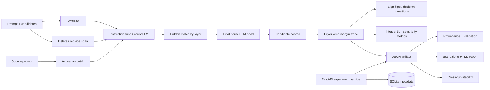

# Struct-XAI Platform

[](https://github.com/cagataykavas/struct-xai-platform/actions/workflows/ci.yml)

Struct-XAI is a compact, runnable interpretability platform for studying **how instruction-tuned causal language models form, revise, and transfer candidate decisions across layers**.

The project deliberately keeps the analysis surface small enough to audit. It exposes the exact scoring assumptions, interventions, activation hooks, experiment metadata, quantitative comparison metrics, and reproducibility checks instead of hiding them behind a generic “XAI” wrapper.

> Public research/demo implementation only. No employer prompts, model artifacts, confidential datasets, or proprietary evaluation material are included.

## Why this project exists

Interpretability experiments are easy to turn into attractive plots and hard to turn into reproducible evidence. Struct-XAI treats an explanation as an **experiment artifact** with three separate questions:

1. **What did the model prefer at each layer?**
2. **Did a controlled intervention causally change the measured decision trace?**
3. **Can another run reproduce the same trace, and can we prove which configuration produced it?**

That separation is reflected directly in the codebase.

## Implemented capabilities

| Area | Implemented |
| --- | --- |
| Layer-wise analysis | final-position hidden-state projection, candidate-aware scores, winner/runner-up trace |
| Decision dynamics | signed candidate margins, sign-flip detection, peak effect layer |
| Prompt interventions | reproducible literal deletion and replacement |
| Causal intervention | single-layer patching plus bounded layer × dose sweeps with prespecified promotion gates |
| Quantitative evaluation | mean/max margin shift, final winner change, sign-flip count, intervention sensitivity |
| Repeatability | pairwise diagnostics plus a prespecified multi-run gate with bounded all-pairs evidence |
| Provenance | experiment fingerprint, prompt/candidate SHA-256, model, metric, device/dtype, runtime versions, source revision |
| Artifact validation | prompt/model/fingerprint checks and base-vs-variant layer alignment |
| Outputs | JSON experiment artifacts and standalone HTML reports |
| Interfaces | installable CLI and FastAPI experiment service |
| Persistence | SQLite experiment metadata for the local reference service |
| Engineering | CPU-only CI, deterministic unit tests, Docker image |

## Architecture



## Install

```bash
python -m venv .venv
source .venv/bin/activate  # Windows: .venv\Scripts\activate
pip install -e '.[dev]'
```

The default runnable examples use `Qwen/Qwen2.5-0.5B-Instruct`. The current Hugging Face adapter supports decoder models exposing a conventional final normalization layer and LM head.

## 1. Run a layer-wise candidate experiment

```bash
struct-xai compare \
  --name turkey-capital \
  --prompt 'Question: What is the capital of Turkey? Answer:' \
  --candidates ' Ankara' ' Istanbul' \
  --delete 'Turkey'
```

This writes both machine-readable and reviewable outputs:

```text
artifacts/turkey-capital.json
artifacts/turkey-capital.html
```

A replacement intervention is equally explicit:

```bash
struct-xai compare \
  --name country-replacement \
  --prompt 'Question: What is the capital of Turkey? Answer:' \
  --candidates ' Ankara' ' Athens' \
  --replace 'Turkey' \
  --with 'Greece'
```

## 2. Understand the layer metric

At each layer, the final-token hidden state is projected through the model's final normalization layer and language-model head. Candidate labels are tokenized and the **first token of each candidate** is scored.

For candidates A and B:

```text
margin(layer) = logit(first_token(A)) - logit(first_token(B))
```

The metric is intentionally named `first_token_candidate_logit_margin`. It is useful for tracing candidate preference formation, but **it is not represented as a full sequence probability or a complete attribution method for multi-token answers**.

A sign flip is recorded when this signed margin changes direction between layers. That provides a compact view of where the internal candidate preference changes rather than looking only at the final output.

## 3. Quantify intervention effects

Every experiment artifact contains quantitative intervention evaluation in addition to trajectories.

For every candidate pair, Struct-XAI reports:

- baseline initial/final and mean absolute margin;
- final margin change after intervention;
- mean and maximum absolute margin shift across layers;
- the layer with the largest intervention effect;
- whether the final pairwise winner changed;
- sign-flip count under the intervention.

Offline validation and metric recomputation require no model download:

```bash
struct-xai evaluate artifacts/turkey-capital.json --fail-invalid
```

The command checks the artifact's experiment identity and structural consistency before reporting the stored decision evidence.

## 4. Measure cross-run explanation stability

Two runs of the same experiment can be compared directly:

```bash
struct-xai stability \
  artifacts/run-a.json \
  artifacts/run-b.json \
  --output artifacts/stability.json
```

For every candidate pair the stability report includes:

```text
Pearson correlation of layer-wise margins
mean / maximum absolute margin difference
layer-wise sign agreement rate
final margin difference
final pairwise winner agreement
```

These metrics quantify **repeatability of the measured decision trace**. A high correlation is not claimed to prove causal faithfulness; faithfulness and repeatability are kept as separate concepts.

For release or CI decisions, use a cohort rather than selecting one convenient
pair of runs after the fact:

```python
from structxai.stability import (
    StabilityCohortPolicy,
    require_artifact_stability_cohort,
)

evidence = require_artifact_stability_cohort(
    {
        "seed-11": run_a,
        "seed-22": run_b,
        "seed-33": run_c,
    },
    policy=StabilityCohortPolicy(
        min_pairwise_pearson=0.95,
        min_pairwise_sign_agreement=0.95,
        max_pairwise_mean_abs_margin_difference=0.05,
        max_final_margin_range=0.05,
    ),
)
```

The gate requires three or more artifacts with identical experiment metadata,
experiment fingerprints, candidate sets, and layer indices. It evaluates every
run pair, reports stable finding codes, and can require final-winner unanimity.
Inputs and work are bounded, non-finite scores are rejected, and the evidence is
deterministic regardless of mapping order. The report commits to each run with
SHA-256 while omitting the raw prompt and layer scores, so CI can retain a
privacy-reduced decision record.

Prespecify both the run cohort and policy thresholds before executing the
experiment. This is a descriptive repeatability gate over a finite set of runs:
it does not establish causal faithfulness, population-level generalization, or
independence between runs. Its digests provide integrity evidence, not signer
authentication.

To move from one experiment to a prespecified task cohort, aggregate the
privacy-reduced run-cohort reports rather than treating their dependent run
pairs as independent samples:

```python
from structxai.stability_uncertainty import (
    StabilityTaskCohortPolicy,
    require_stability_task_cohort,
)

evidence = require_stability_task_cohort(
    {
        "task-001": task_001_stability_report,
        "task-002": task_002_stability_report,
        # At least eight independently selected tasks.
    },
    policy=StabilityTaskCohortPolicy(
        confidence_level=0.95,
        bootstrap_resamples=2_000,
        bootstrap_seed=20261031,
    ),
)
```

The task audit requires the same run policy and run count for every task,
rejects duplicate experiment commitments, and uses each whole task as the
resampling unit. It reports percentile-bootstrap intervals for the mean
task-level worst-pair Pearson correlation, sign agreement, margin drift, and
final-margin range. The accepted-task rate uses a Wilson interval so an
all-passing small cohort does not receive a falsely perfect lower bound. Work
is bounded to 256 tasks and 20,000 resamples, and a counter-based SHA-256 index
stream makes evidence reproducible without relying on process-global RNG
state. This follows the nonparametric resampling principle introduced by
[Efron (1979)](https://doi.org/10.1214/aos/1176344552), while keeping the task
as the independent unit.

Prespecify and pin the task list, task-selection protocol, run policy,
thresholds, confidence level, resample count, and seed before evaluation. The
intervals only characterize variation across the supplied task cohort under an
independent, representative-task assumption. They do not repair task-selection
bias, prove population generalization or causal faithfulness, or authenticate
the input reports. The retained output commits to task and report identities
without storing prompts or layer scores.

### Prespecified public-task manifest and signed evidence

`structxai.stability_manifest` closes the input-authentication gap at the
evidence boundary. Create the manifest **before** running the cohort: it binds
the exact task IDs and experiment commitments, dataset records, selection
protocol, model weights, tokenizer, run policy, and task-level uncertainty
policy. Dataset and model revisions must be immutable 40- to 64-character
hexadecimal revisions; the selected records and artifacts receive separate
SHA-256 commitments.

```python
from structxai.stability_manifest import (
    create_signed_stability_task_evidence,
    create_stability_task_manifest,
    verify_signed_stability_task_evidence,
)
from structxai.stability_uncertainty import StabilityTaskCohortPolicy

manifest = create_stability_task_manifest(
    prespecified_task_experiment_hashes,
    cohort_id="public-xai-v1",
    dataset_uri=public_dataset_uri,
    dataset_revision=dataset_commit,
    dataset_records_sha256=selected_records_sha256,
    selection_protocol_uri=public_protocol_uri,
    selection_protocol_sha256=selection_protocol_sha256,
    model_uri=public_model_uri,
    model_revision=model_commit,
    model_weights_sha256=model_weights_sha256,
    tokenizer_sha256=tokenizer_sha256,
    run_cohort_policy_sha256=run_policy_sha256,
    task_cohort_policy=StabilityTaskCohortPolicy(
        confidence_level=0.95,
        bootstrap_resamples=2_000,
        bootstrap_seed=20261101,
    ),
)

bundle = create_signed_stability_task_evidence(
    manifest,
    completed_task_reports,
    signer=kms_adapter,
)
verification = verify_signed_stability_task_evidence(
    bundle,
    {kms_adapter.key_id: kms_adapter},
)
```

Signing recomputes the cohort audit from the raw task reports and refuses a
task substitution, policy change, or rejected result. The provider-neutral
signer/verifier interface is structurally compatible with the existing
`AwsKmsHandoffAdapter`; only compact digest claims are sent to the external
signer, keeping the message below its 4 KiB raw-message limit. Verification
checks the retained manifest and report digests, their exact task and policy
bindings, the immutable key revision, and the asymmetric signature.

Before evaluating a published manifest, bind it to the concrete runtime inputs
with `run_manifest_locked_stability_cohort`. The gate requires the independently
published manifest digest, reconstructs the existing ordered dataset and bounded
model/tokenizer artifact manifests, checks the exact selection-protocol bytes,
and only then invokes the cohort callback:

```python
from structxai.stability_runtime import run_manifest_locked_stability_cohort

task_reports, runtime_evidence = run_manifest_locked_stability_cohort(
    manifest,
    expected_manifest_sha256=published_manifest_sha256,
    model_path=downloaded_model_directory,
    tokenizer_path=downloaded_tokenizer_directory,
    dataset_examples=selected_dataset_examples,
    selection_protocol=selection_protocol_bytes,
    runner=run_public_stability_cohort,
)

bundle = create_signed_stability_task_evidence(
    manifest,
    task_reports,
    signer=kms_adapter,
)
```

The callback receives resolved, preflight-verified artifact paths and immutable
dataset/protocol values. Its output must contain every committed task with the
exact experiment identity. Reports are canonicalized into a detached snapshot,
and model, tokenizer, and dataset commitments are checked again after execution.
The privacy-reduced runtime evidence binds the input set and full report digests
without retaining prompts, records, weights, or protocol contents. Callback and
filesystem failures are converted to stable errors rather than copying private
diagnostics.

This boundary detects evidence substitution; it is not a trusted timestamp or
remote attestation system. A signature made after seeing results does not prove
that the manifest was prespecified, and declared artifact hashes do not prove
that a malicious callback actually used the verified paths. The runtime gate
narrows accidental substitution and time-of-check/time-of-use drift, but it does
not attest the process, accelerator, dependency graph, or model execution.
Publish the manifest digest in an append-only external record before evaluation
and use an independently attested runner when stronger execution claims are
required. Public provenance also does not make a selected cohort representative
or prove causal faithfulness.

Retaining the runtime record and signed cohort bundle as separate files is not
enough: two individually valid artifacts from different runs of the same manifest
could otherwise be paired after the fact. Use
`create_runtime_bound_stability_evidence` to create one signed lineage envelope:

```python
from structxai.stability_lineage import (
    create_manifest_publication_reference,
    create_runtime_bound_stability_evidence,
    verify_runtime_bound_stability_evidence,
)

publication_reference = create_manifest_publication_reference(
    publication_uri=immutable_publication_uri,
    publication_record_sha256=publication_record_sha256,
    manifest_sha256=manifest["manifest_sha256"],
    published_at_epoch=published_at_epoch,
)
lineage_bundle = create_runtime_bound_stability_evidence(
    manifest,
    task_reports,
    runtime_evidence,
    publication_reference,
    signer=kms_adapter,
)
verification = verify_runtime_bound_stability_evidence(
    lineage_bundle,
    {kms_adapter.key_id: kms_adapter},
)
```

The creator recomputes each full task-report commitment, requires the runtime
record to commit to that exact report set, produces the existing signed cohort
evidence, and signs a compact outer claim over both retained artifact digests
and the canonical publication-reference digest. The strict reference records a
printable-ASCII HTTPS URI without credentials, query, fragment, or explicit port; the exact
manifest digest; the external publication-record digest; and a bounded claimed
publication epoch. Verification checks that reference against the nested
manifest before checking the cohort signature, runtime evidence schema and input
bindings, exact task/report commitment, immutable key revision, and outer
lineage signature. The full public reference is retained in the envelope while
only its digest enters the compact outer claim. The envelope retains hashes and
accepted aggregate evidence, not dataset payloads, prompts, model weights, or
layer scores.

This is evidence-lineage integrity, not proof of execution. It requires two
signing operations and cannot stop a compromised signer, malicious callback, or
unattested runtime. The publication reference is caller supplied: this module
does not fetch the URI, authenticate its publisher, prove the claimed time, or
prove that the record is append-only. Publish the manifest before execution,
validate the external record in the protected workflow, and protect the signer
independently.

`structxai.stability_publication` supplies that protected workflow's offline
content-verification boundary. It creates a bounded canonical publication record and
verifies the exact downloaded bytes, requested URI, raw response digest, claimed epoch,
nested manifest self-digest, and full existing manifest contract before evaluation.
Duplicate keys, reformatting, oversized responses, extra fields, and manifest
substitution fail closed. The network client stays deployment-owned so DNS, egress,
TLS, redirect, proxy, and authentication controls are not hidden inside research code.
See [`docs/manifest_publication_verification.md`](docs/manifest_publication_verification.md).

## 5. Activation patching

```bash
struct-xai patch \
  --source-prompt 'Question: What is the capital of Turkey? Answer:' \
  --target-prompt 'Question: What is the capital of Greece? Answer:' \
  --layer 8 \
  --candidates ' Ankara' ' Athens'
```

The public patching experiment is intentionally narrow and inspectable. It captures the **final-position residual state** from a source run at one transformer layer, injects it into the target run at the same layer, and measures final candidate-logit changes.

This is implemented with real forward hooks; it is not a static diagram standing in for activation patching.

The production-minded dose-response path evaluates intermediate intervention strengths, repeats
the unpatched baseline to detect hook leakage, and can fail a promotion gate on weak endpoint
recovery, non-monotonic behavior, large reversals, or unstable overshoot. A second gate aggregates
matching seed runs and rejects unstable qualification rates, effect signs, endpoints, or AUCs. See
[`docs/activation_patch_dose_response.md`](docs/activation_patch_dose_response.md).

For promotion workflows, `PatchRunSigner` now executes each sweep inside a process-serialized
Python, NumPy, CPU Torch, and capability-aware CUDA seed boundary. It restores every caller RNG
state in `finally`, fails closed on lock contention or CUDA topology drift, and emits a fresh
HMAC-SHA256 receipt. Receipt schema v6 binds the declared seed, CUDA device count, pre/post
RNG-state digests, exact sweep evidence, immutable model/tokenizer artifact digests, issue time,
run identity, signing-key ID, optional distributed-worker seed topology, and optional
distributed sample-order and dataset-content manifests. The
`run_with_worker_plan` path supplies a picklable DataLoader initializer for Python,
NumPy, and CPU Torch in every local worker while committing all rank/worker seeds as
privacy-reduced hashes. `run_with_input_plan` additionally supplies an immutable
rank-local sampler and commits every rank's epoch-specific order without publishing
raw sample indices. Callers can also supply canonical example IDs and payload bytes;
the receipt then binds their ordered SHA-256 commitments, and in-run dataset or sampler
mutation fails closed before signing. An authenticated cross-seed wrapper verifies every receipt and
rejects mixed CUDA, worker, or dataset identities before binding the runs to the aggregate audit. See
[`docs/distributed-worker-seeding.md`](docs/distributed-worker-seeding.md) for the
DataLoader contract and persistent-worker limitation. The strict
`run_with_acknowledged_input_plan` path additionally requires one atomic,
challenge-bound acknowledgment from every expected local worker before signing and
returns its privacy-reduced manifest for independent verification. A coordinator can
provide complete rank receipt sets to require every declared rank before cross-seed
promotion; the audit commits each seed's canonical all-rank manifest. The strict
coordinator ingestion path claims every verified receipt in a restart-safe SQLite
ledger. Operators can create an online snapshot, verify physical and logical state,
and restore a new standby ledger without overwriting existing replay state; the
privacy-reduced manifest commits audit, promotion, and receipt digests without
publishing promotion IDs or audit payloads. The strict
`run_from_artifacts` path computes model/tokenizer identities from bounded, content-addressed
regular-file manifests and rejects mutation across the experiment run.

## Experiment artifact and provenance

A JSON artifact contains:

```text
experiment
├── name / prompt / candidates / model
base
├── layer-wise candidate decisions
└── sign flips
variants
├── intervention metadata
├── changed prompt
└── layer-wise analysis
intervention_evaluation
provenance
├── experiment fingerprint
├── prompt SHA-256
├── candidate SHA-256
├── model + metric
├── requested/resolved device + dtype
├── Python / Torch / Transformers versions
└── source revision when available
```

The provenance validator detects configuration drift, prompt/model mismatch, fingerprint mismatch, and base/variant layer misalignment. This is meant to make a report traceable to the experiment that generated it rather than treating an HTML plot as sufficient evidence by itself.

## HTML reports

`struct-xai report` renders an existing artifact without rerunning the model:

```bash
struct-xai report artifacts/turkey-capital.json
```

The standalone report surfaces:

- model and explicit analysis metric;
- prompt and candidate set;
- layer-wise margin trace;
- decision sign flips;
- intervention summaries;
- quantitative intervention sensitivity;
- experiment fingerprint and runtime provenance.

## Experiment service

Run the reference API:

```bash
uvicorn cloud_service.api:app --reload
```

Endpoints:

- `GET /health`
- `POST /experiments`
- `GET /experiments`
- `GET /experiments/{id}`

Submitted experiments move through queued → running → completed/failed states. Metadata is persisted in SQLite while JSON and HTML artifacts are written under `artifacts/runs/<experiment-id>/`.

The service intentionally keeps orchestration separate from model internals. For a multi-worker deployment, the background-task boundary can be replaced by a durable queue and the metadata adapter by PostgreSQL without rewriting the interpretability core.

## Repository structure

```text
structxai/
  core.py            candidate scoring and layer decisions
  hf_runner.py       Hugging Face model adapter
  interventions.py   controlled prompt mutations
  patching.py        activation patching
  patch_dose_response.py bounded layer/dose sweeps, per-run and cross-seed audits
  patch_run_receipt.py seeded execution boundary and authenticated run provenance
  worker_seeding.py  distributed DataLoader seed plans and topology manifests
  worker_acknowledgment.py strict local-worker execution evidence
  sampler_provenance.py privacy-reduced distributed sample-order manifests
  dataset_manifest.py ordered dataset identity and payload commitments
  artifact_manifest.py bounded model/tokenizer file manifests
  rank_receipt_ingestion.py replay-protected all-rank coordinator ingestion
  rank_ledger_backup.py verified online backup and no-overwrite standby restore
  rank_ledger_handoff.py HMAC or external-signature standby authorization
  aws_kms_handoff.py canonical AWS KMS asymmetric signer/verifier adapter
  aws_kms_live_contract.py bounded opt-in live KMS probe and sanitized evidence
  evaluation.py      intervention-effect metrics
  stability.py       cross-run repeatability metrics
  stability_uncertainty.py task-resampled confidence intervals and policy gate
  stability_manifest.py prespecified public-task manifest and signed evidence
  stability_runtime.py manifest-locked runtime input and report commitments
  stability_lineage.py signed cross-binding of runtime and cohort evidence
  stability_publication.py offline verification of externally published manifest bytes
  provenance.py      fingerprints and artifact validation
  experiment.py      experiment orchestration
  report.py          standalone HTML reporting
  cli.py             command-line interface

cloud_service/       API and metadata persistence
research/            compact public research examples
tests/               deterministic model-free tests
```

## CI philosophy

The default CI path intentionally does **not** download a language-model checkpoint. It validates the deterministic engineering surface using CPU-only PyTorch:

- candidate scoring and margins;
- sign-flip detection;
- deletion/replacement interventions;
- quantitative intervention evaluation;
- provenance validation;
- cross-run stability metrics;
- activation-patch isolation, dose-response and cross-seed stability policy checks;
- bounded model/tokenizer manifests and in-run mutation rejection;
- deterministic distributed-worker seed plans and authenticated topology binding;
- fail-closed local-worker acknowledgment manifests with cross-process validation;
- coordinator-side all-rank acknowledgment aggregation for promotion gates;
- replay-ledger online backup, logical integrity manifests, and standby restore;
- signed, short-lived authority handoffs with external epoch/fence checks, immutable external key revisions, and an AWS KMS adapter contract;
- deterministic distributed-sampler orders, mutation checks, and receipt binding;
- content-addressed dataset manifests and cross-seed dataset identity checks;
- HTML report generation;
- experiment metadata lifecycle;
- CLI/package imports;
- Docker build.

Heavy GPU/model integration belongs in a separate explicit experiment run rather than burning multi-gigabyte CUDA downloads on every documentation commit.

## Methodological boundaries

The repository tries to make its limitations visible:

- first-token candidate margins are not full candidate sequence likelihoods;
- logit-lens projections are diagnostic views, not automatically causal explanations;
- deletion/replacement effects can be confounded by distribution shift;
- activation patching targets one token position per run; dose sweeps evaluate a bounded layer set;
- cross-run stability measures repeatability, not truth;
- dataset manifests authenticate caller-canonicalized bytes, not their semantic correctness or origin;
- a visually clean heatmap is not treated as evidence without an explicit metric and experiment identity.
- signed handoffs authenticate state transfer but do not allocate epochs, fence a source, or provide consensus; the AWS adapter validates key metadata and response identity but still depends on IAM, client timeouts, provider availability, and independently protected epochs.

## Research directions

Next research-oriented extensions include:

- full candidate sequence log-probability scoring;
- candidate-aware gradient/span attribution;
- token × layer heatmaps;
- activation-patching sweeps over layer × token position;
- clean/corrupted causal tracing;
- multi-model comparison matrices;
- compact Turkish instruction-model benchmark suites;
- queue-backed distributed experiment workers.

## Interview topics

**logit lens · hidden states · candidate margins · sign flips · controlled interventions · activation patching · causal vs correlational explanation · explanation faithfulness · repeatability · experiment provenance · artifact validation · model hooks · reproducible research systems · FastAPI · Docker · CI.**


